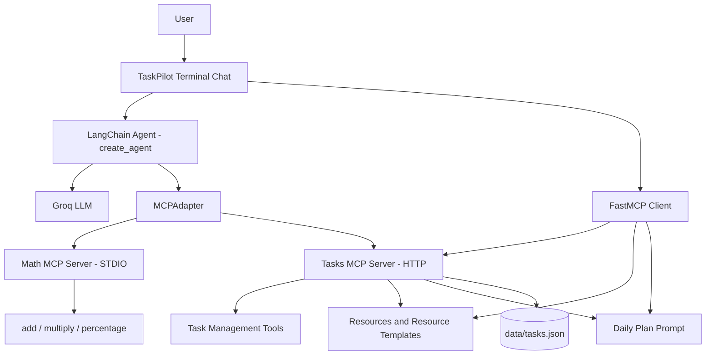

# TaskPilot – AI Productivity Assistant

TaskPilot is an AI-powered productivity assistant built using **FastMCP and LangChain**. It allows users to manage daily tasks and perform mathematical calculations through natural-language conversations.

The project demonstrates how multiple MCP servers can expose tools, resources, resource templates, and prompts, and how a LangChain agent can dynamically discover and use those capabilities through MCP.

## 1. Project Overview

TaskPilot consists of two independent MCP servers:

- **Math MCP Server:** Provides addition, multiplication, and percentage calculations using STDIO transport.
- **Tasks MCP Server:** Provides task-management operations, resources, and prompts using HTTP transport.

A LangChain agent connects to both servers through a single `MCPAdapter`. It dynamically discovers their tools and selects the appropriate tools based on the user's request.

FastMCP Client is used separately for direct tool testing and accessing resources and prompts.

### Key Features

- Mathematical operations: addition, multiplication, and percentage calculation.
- Task creation with low, medium, and high priorities.
- Task listing with status filters.
- Task completion and deletion by ID.
- Search tasks by title keyword.
- JSON-based task persistence.
- Task summary resource.
- Individual task resource template.
- Reusable daily planning prompt.
- Dynamic MCP tool discovery through LangChain MCPAdapter.
- Natural-language interaction through a LangChain agent.
- Conversation memory for follow-up instructions.
- Tool-call visibility and middleware-based error handling.
- Terminal-based chat interface.

## 2. Technology Stack

| Component | Technology |
|---|---|
| Language | Python 3.12 |
| MCP framework | FastMCP 4.x |
| MCP client integration | `langchain[mcp]` |
| MCP tool adapter | `MCPAdapter` from `langchain.mcp` |
| Agent framework | LangChain v1 `create_agent` |
| LLM provider | Groq |
| Model | `openai/gpt-oss-20b` |
| Environment configuration | python-dotenv |
| Task persistence | JSON |
| Testing | pytest, pytest-asyncio |

The project uses the supported `langchain.mcp` integration. It does not use the archived `langchain-mcp-adapters` package or `MultiServerMCPClient`.

## 3. Architecture



### Request flow

1. The user enters a natural-language request in the terminal chat.
2. The LangChain agent interprets the request.
3. The agent selects the appropriate dynamically loaded MCP tool.
4. MCPAdapter forwards the tool invocation to the corresponding MCP server.
5. The server executes the operation.
6. The result is returned through the adapter to the agent.
7. The agent formulates a response for the user.
8. Conversation memory preserves context for follow-up instructions.

For resources and prompts, FastMCP Client is used directly rather than relying on MCPAdapter.

## 4. Understanding MCP Architecture

### MCP Host

The MCP Host is the AI application that coordinates the interaction between the language model and MCP capabilities.

In TaskPilot, the terminal-based TaskPilot application acts as the host. It contains the LangChain agent and manages access to the connected MCP servers.

### MCP Client

An MCP Client manages communication between the host and an individual MCP server.

TaskPilot uses:
- MCPAdapter to expose MCP tools to the LangChain agent.
- FastMCP Client for direct server communication, resource reads, prompt retrieval, and testing.

### MCP Server

An MCP Server exposes capabilities to MCP clients.

TaskPilot has two servers:

**Math MCP Server**
- `add`
- `multiply`
- `percentage`

**Tasks MCP Server**
- `add_task`
- `list_tasks`
- `complete_task`
- `delete_task`
- `search_tasks`

The Tasks server also exposes resources, a resource template, and a reusable prompt.

### MCP capabilities

| Capability | Purpose | TaskPilot implementation |
|---|---|---|
| Tools | Execute operations | Math and task operations |
| Resources | Expose contextual data | Task summary |
| Resource templates | Retrieve parameterized data | `tasks://{task_id}` |
| Prompts | Provide reusable prompt templates | `daily plan` |

## 5. MCP Transport Comparison

TaskPilot uses both STDIO and HTTP transports.

| Feature | STDIO | HTTP |
|---|---|---|
| Communication | Standard input/output streams | HTTP requests |
| Server process | Usually launched by the client | Runs independently |
| Network access | Local process communication | Can support remote access |
| Deployment | Suitable for local tools | Suitable for independently hosted services |
| TaskPilot usage | Math MCP Server | Tasks MCP Server |

### Why two transports?

The Math server is a lightweight local service, so STDIO is appropriate.

The Tasks server runs independently and can be accessed by multiple clients through HTTP. This also allows the FastAPI application to communicate with it separately.

**Tasks MCP server endpoint:** `http://127.0.0.1:8001/mcp`

Port 8001 is used in the current local configuration to avoid a conflict with another application already using port 8000.

## 6. FastMCP Client vs LangChain MCPAdapter

Both are used in TaskPilot, but they serve different purposes.

| Feature | FastMCP Client | LangChain MCPAdapter |
|---|---|---|
| Main purpose | Direct MCP communication | Integrate MCP tools with LangChain |
| Tool discovery | Yes | Yes |
| Direct tool execution | Yes | Exposes tools for agent execution |
| Resource access | Yes | Not the selected approach in this project |
| Prompt retrieval | Yes | Not the selected approach in this project |
| LangChain agent integration | Manual integration required | Directly provides LangChain-compatible tools |

### Why use both?

MCPAdapter dynamically loads tools from both MCP servers and makes them available to the LangChain agent.

FastMCP Client is used when the application needs direct access to resources and prompts, such as:
- Reading the task summary.
- Reading an individual task.
- Retrieving the daily planning prompt.
- Testing server tools and capabilities independently.

This separation keeps tool execution and contextual data retrieval clear.

## 7. Project Structure

```text
taskpilot/
│
├── servers/
│   ├── __init__.py
│   ├── math_server.py
│   └── tasks_server.py
│
├── client/
│   ├── __init__.py
│   ├── mcp_config.py
│   ├── llm.py
│   ├── agent.py
│   └── chat.py
│
├── tests/
│   ├── __init__.py
│   ├── test_math_server.py
│   ├── test_tasks_server.py
│   ├── test_clients.py
│   ├── test_http_client.py
│   ├── test_inmemory_transport.py
│   └── ...
│
├── data/
│   └── tasks.json
│
├── .env.example
├── .gitignore
├── pyproject.toml
├── uv.lock
├── requirements.txt
└── README.md
```

Test module names may evolve as the project is extended.

## 8. Setup and Installation

### Prerequisites

- Python 3.12 or compatible Python 3.10+ environment.
- Git.
- uv package manager.
- A Groq API key.

### Clone the repository

```bash
git clone https://github.com/Ushasri-Katreddi/taskpilot.git
cd taskpilot
```

### Create and activate a virtual environment

```powershell
uv venv
.venv\Scripts\Activate.ps1
```

### Install dependencies

```bash
uv sync --locked
```

The project uses `pyproject.toml` for dependency configuration and `uv.lock` for reproducible dependency resolution. A pinned `requirements.txt` is also provided.

### Configure environment variables

Create a `.env` file in the project root using `.env.example` as a template.

```env
GROQ_API_KEY=your_groq_api_key_here
GROQ_MODEL=openai/gpt-oss-20b
```

Never commit your actual `.env` file or API keys.

## 9. Running TaskPilot

TaskPilot uses two MCP servers and one terminal client.

### Terminal 1 – Start the Tasks MCP Server

```bash
uv run python -m servers.tasks_server
```

The Tasks MCP server runs at:

```text
http://127.0.0.1:8001/mcp
```

### Terminal 2 – Start the TaskPilot Agent

```bash
uv run python -m client.chat
```

The MCP configuration starts the Math MCP server through STDIO and connects to the running Tasks MCP server through HTTP.

The agent discovers the tools dynamically and makes them available during the chat session.

### Example interactions

```text
Create a high-priority task called Prepare client demo.

Add a low-priority task called Clean my desk.

Show my pending tasks.

Mark the first one as done.

What percentage of my tasks are completed?

Complete task 99.

Add a task with urgent priority.

 /summary

 /task 1

 /plan high priority

exit
```

The percentage tool calculates what percentage one value represents of another. For requests such as "25 percent of 200", the agent uses multiplication with `200 * 0.25`.

## 10. Testing

Run the automated tests:

```bash
uv run pytest
```

Some HTTP integration tests require the Tasks MCP server to be running.

The project includes tests for:

- Math tool operations and division-by-zero handling.
- Task creation, listing, completion, deletion, and search.
- Priority and task-ID validation.
- Summary resource and task resource template.
- Daily plan prompt.
- STDIO and HTTP MCP client integration.
- In-memory transport testing.
- MCPAdapter tool discovery and server namespacing.
- LangChain agent interaction and conversation memory.
- Middleware-based error handling.

### Required test scenarios

| # | Scenario | Expected result |
|---|---|---|
| 1 | Add a high-priority client demo task | Task is created and saved |
| 2 | Add a low-priority clean desk task | Second task is created |
| 3 | Show pending tasks | Pending filter is used |
| 4 | Mark the first task as done | Conversation memory resolves the correct task |
| 5 | Calculate percentage of completed tasks | Task and math tools are both used |
| 6 | Complete task 99 | Clear error without application crash |
| 7 | Add a task with urgent priority | Validation error is explained |
| 8 | Run `/summary` | Task summary is displayed |
| 9 | Run `/task 1` | Task details are displayed |
| 10 | Run `/plan high priority` | Plan is generated from pending tasks |
| 11 | Restart server and list tasks | Previously saved tasks remain available |

## 11. Persistence

Tasks are stored in:

```text
data/tasks.json
```

Each task contains:

- ID
- Title
- Priority
- Status
- Created date and time

The Tasks MCP server reads and writes this JSON file when task operations are performed. This allows tasks to remain available after the server is restarted.

## 12. Optional Extensions and Future Enhancements

The following extensions are separate from the mandatory implementation and can be developed incrementally:

- Delete confirmation using MCP elicitation and a LangGraph interrupt.
- Bulk task creation with progress reporting through FastMCP Context.
- MCPAdapter caching comparison.
- Bearer-token authentication.
- MCP Inspector testing.
- Server composition through mounting or importing.
- A third weather or file-reader MCP server.
- A Streamlit or Gradio user interface.

An additional React + TypeScript frontend with FastAPI integration is also being developed separately.

## 13. Learning Outcomes

This project provides practical experience with:

- MCP host, client, and server architecture.
- Building tools, resources, resource templates, and prompts using FastMCP.
- Context logging and in-memory testing.
- Choosing between STDIO and HTTP transports.
- Connecting multiple MCP servers through MCPAdapter.
- Integrating MCP tools with LangChain v1 agents.
- Conversation memory and follow-up handling.
- Middleware-based tool error handling.
- Testing MCP capabilities independently from the agent.

---

**Repository:** https://github.com/Ushasri-Katreddi/taskpilot

**Project:** TaskPilot – AI Productivity Assistant Using FastMCP and LangChain